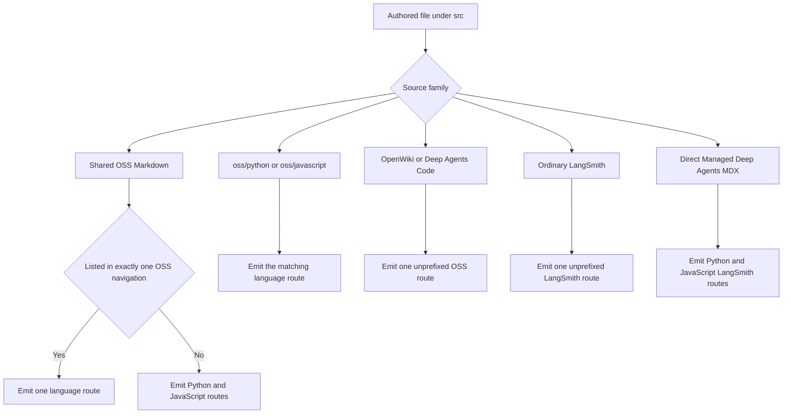

# Documentation Routes and Language Versioning

`DocumentationBuilder` turns `src/` into the disposable `build/` tree. A source file's family owns its output route family. `src/docs.json` is a separate projection contract: it supplies navigation and redirects, and it selects the emitted language set only for **shared OSS Markdown**. It is copied as a shared file; it does not emit pages.

Keep these contracts independent:

1. **Source-family ownership** determines route shape and the rendering target.
2. **Navigation projection** determines where readers encounter routes and can select one output for shared OSS Markdown.
3. **Redirects** retain public URLs; they neither create artifacts nor grant ownership.
4. **The language switcher** is client-side navigation between recognized paired prefixes; it neither generates nor validates routes.

This distinction is important because the Build menus combine families. Managed Deep Agents is authored in `src/langsmith/`, while OpenWiki is authored in `src/oss/openwiki/`; both are projected into Build navigation.

## Source ownership and emitted routes

The full-build route decision: source ownership is primary, with `docs.json` consulted only at the shared-OSS navigation branch.

| Authored source family | Full-build output | Rendering target |
| --- | --- | --- |
| Shared `src/oss/` Markdown, excluding owned and special trees | One or both `/oss/python/...` and `/oss/javascript/...` routes | `python` and/or `js` |
| `src/oss/python/...` | `/oss/python/...`, omitting the ownership segment | `python` |
| `src/oss/javascript/...` | `/oss/javascript/...`, omitting the ownership segment | `js` |
| `src/oss/deepagents/code/...` | `/oss/deepagents/code/...` | `python` |
| `src/oss/openwiki/...` | `/oss/openwiki/...` | `python` |
| Ordinary `src/langsmith/...` | `/langsmith/...` | `python` |
| Direct `src/langsmith/managed-deep-agents*.mdx` | `/langsmith/python/...` and `/langsmith/javascript/...` | `python` and `js` |

`build_all()` recreates `build/`, renders ordinary OSS Python and JavaScript trees, then unversioned Deep Agents Code and OpenWiki, ordinary LangSmith, and Managed Deep Agents variants, before copying shared files and npm snippets. Treat a clean full build—not a menu edit—as the final route-shape check. Source collection rejects symlinks and files resolving outside its root, preventing a source-tree link from importing host content into an artifact.

### Shared OSS selection

For a shared `.md` or `.mdx` page, the builder recursively collects `/oss/python/...` and `/oss/javascript/...` routes from navigation and caches them until `docs.json` changes. A page listed in exactly one language emits only that language; one listed in both, or neither, emits both. Non-Markdown shared OSS files emit for both languages.

A navigation directory entry can represent `dir/index`, but does not select the shared index in a language where `src/oss/<language>/dir.mdx` or `.md` already owns that route. Language-owned directories remain ownership boundaries regardless of navigation. If `docs.json` is missing or invalid, selection falls back to both variants rather than silently suppressing one. `build_file()` uses the same selection rule as `build_all()`, so targeted development rebuilds agree with clean builds.

## Rendering and link transformation

Shared content can contain `:::python` and `:::js` blocks. For its target, a closed matching block contributes its content without fences and a closed nonmatching supported block is removed. Escaped `\:::` becomes literal `:::`, while unsupported labels and unclosed blocks remain intact. An invalid target raises `ValueError`.

Conditional handling is a whole-document regular-expression transformation, not a Markdown-code-fence-aware parser. Avoid nesting conditional blocks and escape a marker intended as literal text. The shared Async subagents page demonstrates the risk: it is projected under Delegation in both Deep Agents navigations even though it contains Python-only conditional material.

For Markdown and MDX, processing occurs in this order:

1. Resolve `@[]` autolinks, using the target as default scope.
2. Add UTM parameters to LangSmith CTA links.
3. Apply conditional rendering.
4. For a language target, scope eligible snippet imports to its language copy.
5. Rewrite eligible OSS links, then Managed Deep Agents links.

The internal target `js` maps to the `javascript` URL segment, and a `.md` source writes an `.mdx` artifact.

### Links and snippets

Eligible absolute `/oss/...` Markdown destinations and quoted `href` values gain `/oss/python/` or `/oss/javascript/`. Images, already-prefixed paths, and the unversioned `/oss/deepagents/code` and `/oss/openwiki` families are preserved. Therefore an unversioned product or ordinary LangSmith page rendered with the Python target defaults its ordinary OSS links to Python without inventing versioned routes for the unversioned product.

Bare Managed Deep Agents links are similarly rewritten to the target language; an already prefixed target stays pinned. This permits one source to link to the corresponding variant without authors manually repeating target prefixes.

Shared Markdown snippets are emitted below both `build/snippets/python/` and `build/snippets/javascript/`, with conditional rendering and absolute rewritten links. Target-language pages rewrite eligible `from '/snippets/...mdx'` imports to those copies, whereas already scoped imports are unchanged. The original snippet path remains a Python-targeted default for unversioned consumers.

## Unversioned products and Managed Deep Agents

Deep Agents Code and OpenWiki are explicit unversioned OSS exceptions. They emit once at `/oss/deepagents/code/...` and `/oss/openwiki/...`; the Python rendering target selects Python conditional content but does not make a Python URL. OSS link rewriting preserves both families while prefixing eligible ordinary OSS links.

`docs.json` lists the same unprefixed OpenWiki routes in both Build dropdowns, and `language-toggle.js` hides its switcher on `/oss/openwiki` and descendants. Deep Agents Code is projected separately and retains compatibility redirects from former Python and JavaScript roots, including wildcard descendants, to its unprefixed route family. These redirects are URL compatibility, not evidence of output ownership.

Ordinary LangSmith pages emit once under `/langsmith/` with the Python target. Direct top-level `managed-deep-agents*.md` or `.mdx` sources are the exception: targeted builds emit Python and JavaScript variants and do not emit an unversioned page. The full build discovers only direct `.mdx` Managed Deep Agents files, so a page that must appear in a clean full build must meet that convention.

The Python and TypeScript Managed Deep Agents tabs have parallel **Get started**, **Agent capabilities**, and **Build and deploy** groups. Both include Identity, a nested Channels group, and Custom frontend. `docs.json` redirects the unversioned landing aliases and listed unversioned page URLs to Python routes; this compatibility default does not remove the JavaScript artifacts. The runtime page intentionally uses conditional blocks for different runtime type names and absent-sandbox values, so its paired artifacts legitimately differ.

The quickstart is likewise one direct Managed Deep Agents source: it branches between Python and JavaScript setup commands, has `mda dev` start a local Agent Server and open Studio, and has `mda deploy` package the project as a hosted Agent Server deployment. In an agent-based workspace, local tracing errors until the agent is registered. These are documentation semantics rendered into the paired route artifacts, not a separate navigation rule.

Ordinary LangSmith workspace guides remain unversioned. Navigation projects `agent-registry`, `agent-environments`, `navigate-agents`, `create-an-agent`, `build-an-agent`, and `deploy-to-agent-environment` together under **Products and setup → LangSmith setup → Agent-based workspaces**. Language-specific examples inside one of those pages do not imply a paired route.

## Reader-side language switching

The language-toggle script recognizes only `/oss/python/` ↔ `/oss/javascript/` and `/langsmith/python/` ↔ `/langsmith/javascript/`. On a Python, TypeScript, or JavaScript selection it records the source path, hash, target language, and timestamp in `sessionStorage`. For a recognized counterpart, its capture-phase click handler suppresses Mintlify's default navigation and directly assigns the counterpart while preserving the hash.

The stored record is a fallback for a full reload. It is consumed at most once and ignored after eight seconds; unavailable `sessionStorage` degrades gracefully. An unprefixed page has no computed counterpart, so the script leaves normal landing-page navigation in place. The switcher does not verify that the counterpart artifact exists—check generated files, navigation projection, and redirects separately.

## Safe route changes

1. Select the source family first. Use an owned OSS directory for intrinsically SDK-specific pages; use shared OSS plus one-language navigation membership when one source should emit only one target.
2. Update both navigation projections when a paired route is intended. For an unversioned product, deliberately use its unprefixed route in each relevant projection.
3. Add redirects only for supported or retired public URLs. Each redirect destination must be an emitted route; a redirect never substitutes for emitting it.
4. Run a clean full build and check both required artifacts and prohibited siblings, especially for a page selected for one language only.
5. Inspect target output for conditional content, scoped snippet imports, OSS links, and Managed Deep Agents links. Extend focused builder tests for classification, selection, transformations, and route shape; test the switcher separately for both prefixes, hashes, reload fallback, expiry, and unversioned exceptions.

## See also

- [Build system](/openwiki/architecture/build-system.md)
- [Source map](/openwiki/architecture/source-map.md)
- [Mintlify integration](/openwiki/integrations/mintlify.md)
- [Conditional rendering](/openwiki/testing/conditional-rendering.md)
- [LangSmith agent documentation workflow](/openwiki/workflows/langsmith-agent-documentation.md)
- [Versioned content workflow](/openwiki/workflows/versioned-content.md)
