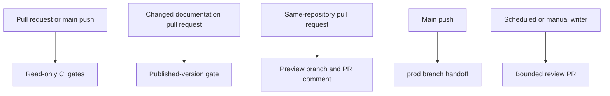
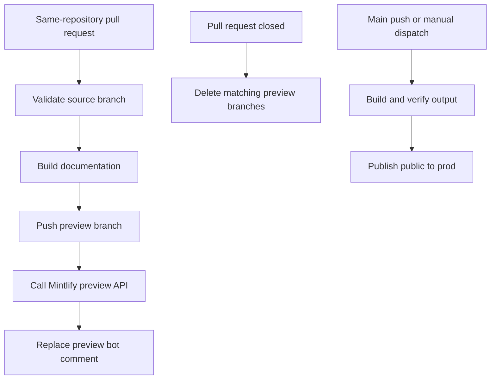

## Automation boundaries

GitHub Actions distinguishes validation from workflows that can change repository or deployment state. Authored documentation lives in `src/`; generated `build/`, preview branches, `prod`, and automation branches are outputs, not authoring surfaces. Read-only checks should remain read-only. Writers may create only their named deployment artifact or review pull request and do not merge their own output.

The local `.github/actions/uv_setup` composite action is the shared Python bootstrap. It pins `astral-sh/setup-uv@v7` to uv `0.9.26`, requires a major.minor Python input, and tolerates an empty cache so post-cleanup does not fail if a job exits before `uv sync` or `uv run`. Reuse it rather than choosing a separate uv version in a workflow.



*Validation reads the repository; write-capable paths produce either a generated deployment handoff or a reviewable pull request.*

### Credential and fork boundary

Credentialed code-sample execution is unavailable to fork pull requests because samples can require repository secrets. The **Test Code Samples** jobs run on scheduled and manual events, or on a pull request only when its head is not a fork. Similarly, the preview build-and-push job runs only for same-repository pull requests or manual dispatch. A skipped fork job is not evidence that credentialed integrations passed.

Keep tokens and secrets out of command output, job summaries, bot comments, and pull-request bodies. Grant write permissions at the individual job boundary rather than converting a validation workflow into a writer. In particular, the preview workflow defaults to read permissions, elevating only branch cleanup and creation to `contents: write` and its comment job to `pull-requests: write`.

## Core CI gates

`ci.yml` runs on pull requests, pushes to `main`, and manual dispatch. It calls reusable test, lint, and documentation-link workflows, and separately detects unresolved merge-conflict markers, cross-reference failures, invalid external-documentation URL schemes, and generated provider-overview drift. Its concurrency key combines workflow and ref and cancels an obsolete run when a newer push arrives for that branch or pull request.

| Gate | Contract |
| --- | --- |
| Tests | `_test.yml` accepts a Python version and working directory, synchronizes the `test` group, and runs `make test`; callers using `./libs/server` also run server integration tests. |
| Lint | `_lint.yml` accepts the same inputs, synchronizes the `test` group, and runs `make lint` with GitHub-format Ruff annotations. |
| Documentation links | `_check-links.yml` has read-only contents permission and a 20-minute timeout. It synchronizes test dependencies, uses Node 22 and the Mintlify CLI cache, then runs anchor-link and OpenAPI checks. |
| Generated overview | CI regenerates `src/oss/python/integrations/providers/overview.mdx` and fails on a diff, except for the designated automated package-download update or a `bypass-auto-check` PR label. |

Do not hand-edit the generated provider overview. Update its generator or package metadata, regenerate it, and commit the result. For local triage, use the narrow target that corresponds to the failed gate:

```bash
make test
make lint
make check-cross-refs
make broken-links-with-anchors
make check-openapi
uv run python scripts/refresh_integration_downloads.py --check-docs-urls
uv run python pipeline/tools/partner_pkg_table.py
```

`make build` installs npm dependencies and invokes the pipeline build command; that command requires the source directory, creates `build/`, and delegates transformation to `DocumentationBuilder.build_all()`.

## Version-claim safeguards

Two workflows cover different kinds of documentation-version drift.

**Check version claims** is a read-only, 10-minute pull-request gate. It runs only when `src/**/*.mdx`, its checker, its ignore list, or the workflow changes. After a full-history checkout, it computes changed MDX files relative to the PR base; with no changed documents it exits successfully without setting up Python. Otherwise it invokes `scripts/check_version_claims.py --files`.

That checker verifies that named `>=` and `==` package versions were actually published, rather than deciding whether a minimum version should be raised. It selects PyPI or npm from scoped-package and extras syntax, nearby language labels, code fences, and page paths. Registry lookup failures are reported as unresolved rather than falsely calling a version invalid, so a registry outage or private package does not fail the check. An ignored known-good specifier is excluded from the result.

**Refresh external version requirements** handles a different case: documentation that deliberately mirrors an upstream-owned requirement registered in `scripts/data/external_versions.yaml`. Every Monday at 08:00 UTC, or on manual dispatch, its `refresh` job runs `scripts/check_external_versions.py --write`. If mirrored `src/` content changed, it appends a commit to the one open `chore/refresh-external-versions` PR or force-pushes that branch and opens a new PR; it does not merge. The script rewrites only the captured version digits, so reviewers must still verify surrounding prose, flags, and peer requirements.

Its separate `sweep` job has read-only contents permission and runs the package-version checker across all pages with `--advisory-only`. This catches an unpublished version on an untouched page without turning a scheduled run red.

## Code-sample matrix and escalation

**Test Code Samples** runs for relevant sample changes on eligible PRs, on manual dispatch, and at 00:00 UTC on the first of every month. Its non-fail-fast `oss` and `langsmith` legs prevent one product's failure from masking the other. The OSS leg owns `langchain`, `langgraph`, and `deepagents`; the LangSmith leg owns `langsmith`. A coverage check fails if any top-level sample product directory belongs to neither leg.

For a same-repository PR, each leg computes the merge-base diff and passes changed supported sample files to `make test-code-samples`; scheduled and manual runs test all samples. Jobs provision pgvector PostgreSQL plus Python and uv, Node, Java with JBang, and Go. Full runs use a longer timeout than PR runs.

Only the OSS leg of a scheduled or manual full run can regenerate trace-linked snippets. The test step continues after an error, but the job later fails if samples failed. Regeneration requires a non-cancelled test, fewer than 20 sample failures, and updated traces. If the two generated trace paths differ, the workflow appends to an open `chore/refresh-code-sample-traces` PR or creates it; it does not merge.

A downstream workflow observes completed **Test Code Samples** runs. Only failed or cancelled scheduled runs can create product-specific Linear tickets. If no product leg reported, it creates a generic ticket; if the team-key configuration is absent, it warns rather than filing. This observer is escalation, not a retry mechanism.

## Review-PR writers

Scheduled writers are bounded: no diff means no commit, an open standing branch is reused where configured, and a human reviews the PR.

- **LangSmith OpenAPI refresh** runs daily and manually. It uses a GitHub App token for checkout and branch/PR writes, processes the specification, and maintains at most one open refresh PR: it appends to the branch when open and creates a PR only for a changed generated specification. The processor allows network fetches only from `api.smith.langchain.com` and writes `src/langsmith/langsmith-platform-openapi.json`.
- **Weekly changelog** runs on Mondays and accepts manual date-window and dry-run inputs. It uses a GitHub App token for writes, refuses to overwrite a dated branch containing non-bot commits, and creates or updates a review PR rather than merging it. Dry runs limit their summary to candidate public entries rather than a detailed report that could disclose private or unreleased work.
- **OpenWiki Update** runs daily at 08:00 UTC or manually. It checks out full history so `openwiki code --update` can diff against the last documented commit, installs OpenWiki and Mermaid validation dependencies, and limits the generated pull request to `openwiki`, `AGENTS.md`, and its workflow. It uses an App token to open the standing `openwiki/update` PR so normal pull-request workflows are triggered rather than awaiting manual approval.

GitHub App tokens are used for writer PRs when a `GITHUB_TOKEN`-created PR would not automatically trigger pull-request workflows. This is a delivery boundary, not approval authority: the writers propose changes and do not merge them.

## Previews and publication



*Preview state is disposable and PR-scoped; production receives a separate generated handoff from `main`.*

Preview creation validates the source branch, builds documentation, and pushes a collision-resistant `preview-` branch containing `build/`. On close, cleanup derives the matching sanitized prefix and refuses to delete a branch without the `preview-` prefix. The Mintlify comment job requires credentials and a preview branch, posts that branch to the preview API, and fails on malformed JSON or an error response with neither a status ID nor preview URL.

For a successful non-Dependabot pull request, the comment job removes prior marker or legacy preview bot comments before creating one current comment. It ranks changed routable Markdown pages by diff size and lists at most five; code-sample and snippet paths are excluded from that list. See [Mintlify Integration](/openwiki/integrations/mintlify.md) for the generated-tree and hosted-preview boundary.

`publish.yml` runs on a `main` push or manual dispatch. It builds documentation, verifies that `build/` exists, copies it under `public/build`, and publishes `public` to `prod` with the GitHub token. This is a deployment handoff, not a branch for manual documentation edits.

## Safe-change checklist

1. Use `.github/actions/uv_setup` for Python/uv bootstrap; do not silently drift its uv pin.
2. Keep validation read-only and preserve same-repository guards wherever a job needs secrets or repository writes.
3. Add every new `src/code-samples/` product directory to exactly one matrix leg.
4. Keep trace refresh OSS-only, full-run-only, gated by cancellation, failure count, and trace changes, and limited to its two generated paths and review PR.
5. Treat package publication checks, upstream mirror rewrites, and advisory sweeps as separate controls; do not turn a mirrored rewrite into an unreviewed prose change.
6. Preserve no-diff and standing-PR behavior for scheduled writers. Never publish secrets or private reports in summaries, comments, or generated material.
7. Preserve preview branch sanitization and deletion guards; do not enable credentialed preview paths for forks.

## Related pages

- [Mintlify Integration](/openwiki/integrations/mintlify.md)
- [Testing and Validation Overview](/openwiki/testing/test-overview.md)
- [Runnable Code Samples and Snippet Generation](/openwiki/workflows/code-sample-lifecycle.md)
- [LangSmith OpenAPI Refresh](/openwiki/workflows/langsmith-openapi-refresh.md)
- [Agent Instructions and Authoring Skills](/openwiki/operations/agent-skills.md)
