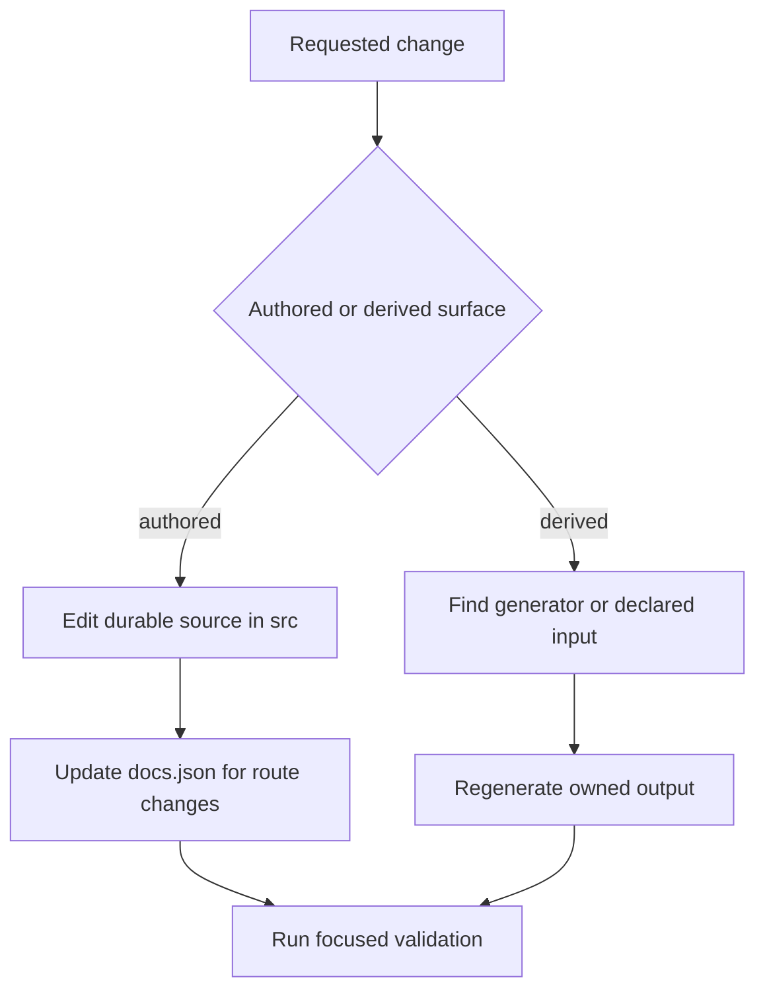

# Repository Wiki Quickstart

This repository builds the Mintlify site at [docs.langchain.com](https://docs.langchain.com) from authored `src/` content. Start with the durable input, not a visible route: `build/`, deployment-generated endpoint pages, extracted snippets, and generated tables are outputs with separate owners. The generated SDK reference at `reference.langchain.com` is built outside this repository.

## Route the task

| Change request | Start with | Follow the owning guide |
| --- | --- | --- |
| Add, move, retire, or revise an authored page, image, frontmatter, navigation item, or redirect | The applicable `src/` file and `src/docs.json` | [Repository Source Map](/openwiki/architecture/source-map.md) |
| Decide an OSS, LangSmith, OpenWiki, Deep Agents Code, or Managed Deep Agents route | The source family and matching navigation entry | [Documentation Routes and Language Versioning](/openwiki/concepts/versioning.md) |
| Change build behavior, a preprocessor, generated output, or local watch behavior | `pipeline/` and the invoking Make target | [Repository Source Map](/openwiki/architecture/source-map.md) |
| Change a runnable example, code extract, trace link, or sample CI behavior | `src/code-samples/` and its consumer page | [Runnable Code Samples and Snippet Generation](/openwiki/workflows/code-sample-lifecycle.md) |
| Change a LangSmith agent workspace, registry, environment, or trace-routing guidance | The owning `src/langsmith/` page and its navigation entry | [LangSmith Agent and Observability Documentation Changes](/openwiki/workflows/langsmith-agent-documentation.md) |
| Change a GitHub workflow, scheduled job, preview, publication path, secret-bearing job, or CI check | `.github/workflows/` and the command it invokes | [GitHub Actions and CI Automation](/openwiki/integrations/github-actions.md) |
| Change OpenAPI input or endpoint reference behavior | The declared `src/docs.json` OpenAPI source and its refresh process | [Mintlify Integration](/openwiki/integrations/mintlify.md) |
| Report generated SDK API-reference content | The reference-documentation issue template | This repository routes reports but does not build `reference.langchain.com`. |

`AGENTS.md` is the repository-wide authoring contract. It requires manually authored `src/` content, Markdown-free frontmatter descriptions, Tabler icons, navigation updates for new pages, and tested examples. Task-specific procedures live in `.agents/skills/`; select the matching skill instead of copying its procedure into a general edit. Claude Code users run `make skills` in each worktree to link that tree into `.claude/skills/`. A change to a script, workflow, Make target, PR check, scheduled job, or skill also requires the `docs-tooling-notion` follow-up before PR handoff.

## Choose the owner before changing output

*Route changes from a durable owner through regeneration and focused validation; review derived files as evidence, not as an authoring surface.*

| Surface | Durable owner and safe action |
| --- | --- |
| Page prose, assets, reusable MDX, or site styling | Edit the appropriate location under `src/`. Reader-facing navigation labels can differ from source directories. |
| Navigation, site settings, redirects, and OpenAPI declarations | Update `src/docs.json`. A new page needs its navigation entry to be discoverable. |
| Shared OSS documentation | Use its source under `src/oss/`; most content emits Python and JavaScript route variants. |
| OpenWiki or Deep Agents Code | Use `src/oss/openwiki/` or `src/oss/deepagents/code/`; these are unversioned OSS output exceptions. |
| LangSmith or Managed Deep Agents documentation | Use the owning `src/langsmith/` page. LangSmith is ordinarily unversioned; Managed Deep Agents has dedicated language-variant behavior. |
| Build tree | Do not edit `build/`. A full `DocumentationBuilder` build clears and recreates it from source, transformations, and shared files. |

For shared OSS `@[ref]` references, an unfenced reference must resolve in both Python and JavaScript scopes. Put an API name that exists in only one scope inside `:::python` or `:::js`, then run `make check-cross-refs`.

## Generated and deployment boundaries

When a visible file is derived, change its owner and regenerate it instead.

| Encountered surface | Change instead | Follow-through |
| --- | --- | --- |
| `build/` | Authored source, `src/docs.json`, or `pipeline/` | Run `make build`, a focused preview, or the affected check. |
| `src/code-samples-generated/` | Marked runnable source in `src/code-samples/` | Test the sample, then run `make code-snippets`. |
| `src/snippets/code-samples/` | The marked runnable sample | Regenerate and review the committed MDX output. |
| `src/oss/python/integrations/providers/overview.mdx` | `packages.yml` or `pipeline/tools/partner_pkg_table.py` | Run `uv run python pipeline/tools/partner_pkg_table.py`; CI rejects drift. |
| Egress tables in `cloud.mdx` and `cloud-platform-features.mdx` | `src/langsmith/egress-ip-addresses.json` | Run `uv run python scripts/generate_egress_ip_tables.py` and commit the inventory and both generated tables together. |
| Agent Server, Control Plane, or LangSmith REST endpoint pages | Their `src/docs.json` declaration and committed or remote OpenAPI source | Mintlify creates endpoint pages at deployment time, so they are absent from local `build/`. |
| `reference.langchain.com` API pages | The external reference-documentation process | File the repository's reference-docs issue when reporting a problem. |

The egress inventory is also published unchanged at `/langsmith/egress-ip-addresses.json` for customers to poll. Its generator accepts only its strict, scoped public-IP inventory and derives the inventory hash plus the two marked table blocks; `--check` reports either hash or table drift. Do not hand-edit a derived table or the inventory `version`.

Runnable samples are source, not display-only fixtures. `make test-code-samples` executes programs under `src/code-samples/`; `make code-snippets` extracts marked regions into the ignored intermediate and generates imported MDX under `src/snippets/code-samples/`. Make the program correct first, execute it, then regenerate its display fragments. The sample workflow skips fork PRs because some samples need secrets, runs changed supported samples on same-repository PRs, and runs all samples on scheduled or manually dispatched runs. Only OSS full runs enable trace collection; a trace refresh can regenerate snippets and open or update its review PR only after a non-cancelled run has fewer than 20 sample failures and updated traces.

## Agent-workspace changes

Agent-workspace documentation belongs under `src/langsmith/` and is navigated as **Products and setup → LangSmith setup → Overview → Agent-based workspaces**. Route registry, environment, navigation, creation, build, and deployment questions to the pages declared there.

The core model is stable: an agent-based workspace registers agents; each trace belongs to one agent and one of its fixed environments. An agent identifier addresses traces and remains stable when its display name changes. Trace-to-agent guidance is Cloud-only: create the target agent, use an API key from that workspace, and configure an agent identifier and environment in the application or its environment variables. Self-hosted and project-based workspaces use the project-based tracing path instead.

## Develop and validate at the changed boundary

Python 3.13 or later is required. Run `make install` to synchronize all Python dependency groups, install project npm dependencies and the global Mintlify CLI, and link Claude Code skills. `make dev` initially builds unless `--skip-build` is supplied, watches `src/`, and starts `mint dev --port 3000` from `build/`; it exits rather than serving stale output when the initial build fails.

| Changed contract | Proportionate first check |
| --- | --- |
| Focused prose | `make lint_prose FILES="src/path/to/page.mdx"` |
| Navigation, redirects, routes, links, or anchors | `make broken-links-with-anchors` |
| Shared or conditional `@[ref]` reference | `make check-cross-refs` |
| Package version specifier in an MDX page | `uv run python scripts/check_version_claims.py --files src/path/to/page.mdx` |
| Pipeline, generator, or CLI behavior | Focused `make test TEST_FILE=tests/unit_tests/...`, then `make lint` as applicable |
| Egress inventory or table | `make test TEST_FILE=tests/unit_tests/test_egress_ip_inventory.py`, then `uv run python scripts/generate_egress_ip_tables.py --check` |
| Runnable sample or extraction marker | `make test-code-samples FILES="src/code-samples/..."`, then `make code-snippets` |
| Agent Server OpenAPI input | `make check-openapi` |
| Provider overview or external integration URL input | Run its owning generator or URL check from the relevant workflow guide |

The version-claim workflow applies to pull requests that change MDX docs or its own checker configuration. It finds changed `src/**/*.mdx` files and checks each named `>=` or `==` package version against PyPI or npm. The checker uses package syntax, nearby language labels, conditional fences, and page paths to decide the registry; it blocks versions that were never published, while stale-but-published floors are only notes and unavailable registry lookups do not become false failures.

`make test` runs pytest against `tests/unit_tests` with network sockets disabled except Unix sockets. Core CI runs on pushes to `main`, pull requests, and manual dispatch. It invokes test, lint, and link gates, and separately checks merge-conflict markers, cross-references, external integration documentation URL schemes, and generated provider-overview drift. Local focused checks provide fast feedback; run generated-site checks when a change can affect emitted routes, imports, redirects, or anchors, and rely on CI for credentialed sample behavior.

## Continue by domain

- [Repository Source Map](/openwiki/architecture/source-map.md): durable source owners, generated inputs, and deployment boundaries.
- [Documentation Routes and Language Versioning](/openwiki/concepts/versioning.md): source-family selection, conditionals, link rewriting, and route variants.
- [Mintlify Integration](/openwiki/integrations/mintlify.md): site configuration, navigation, OpenAPI, previews, and deployment handoff.
- [Testing Overview](/openwiki/testing/test-overview.md): local, generated-site, and CI-only validation.
- [Agent Instructions and Authoring Skills](/openwiki/operations/agent-skills.md): global rules, skills, and tooling follow-up.
- [Runnable Code Samples and Snippet Generation](/openwiki/workflows/code-sample-lifecycle.md): markers, runners, generated snippets, traces, and CI operations.
- [LangSmith Agent and Observability Documentation Changes](/openwiki/workflows/langsmith-agent-documentation.md): agent workspaces, tracing, observability, and related samples.
- [GitHub Actions and CI Automation](/openwiki/integrations/github-actions.md): workflow authority, secrets boundaries, scheduled writers, previews, and publication.
